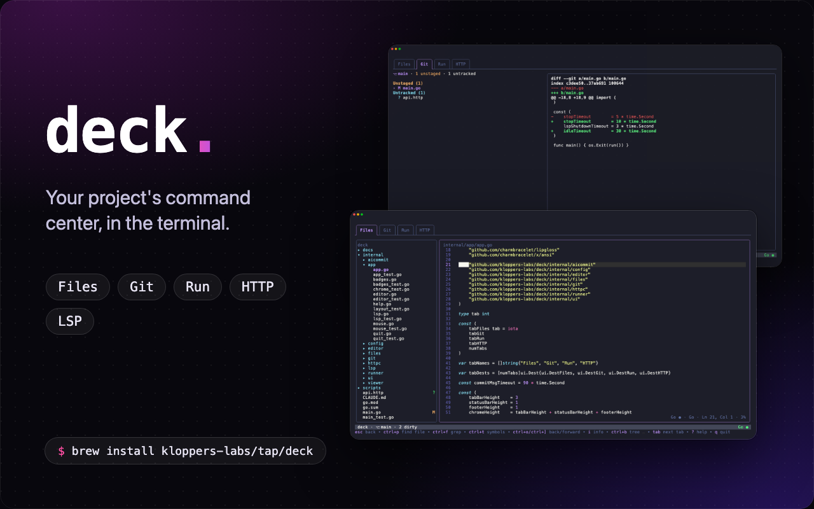
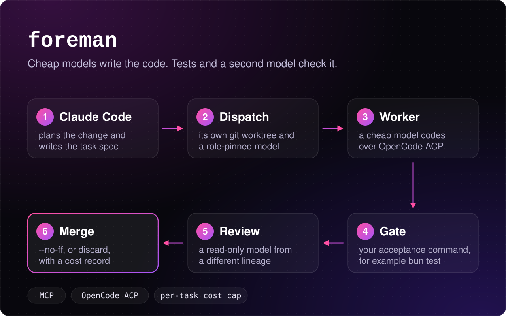

  

  
  
  

Kloppers Labs is home to the open-source projects of [Gerhard Kloppers](https://kloppers.dev). Each one started because something annoyed me, I got curious, or I wanted better tools for my own DJ sets, so they're built to be used every day, not just demoed.

<table>
  <tr>
    <td width="50%" valign="top">
      
      <h3><a href="https://github.com/kloppers-labs/deck">deck</a></h3>
      
Your project's command center in the terminal. Browse code with go-to-definition and hover docs, review diffs and commit, run tasks and send HTTP requests, all from one fast TUI.

      

        
        
        
      

      <code>brew install kloppers-labs/tap/deck</code>
    </td>
    <td width="50%" valign="top">
      
      <h3><a href="https://github.com/kloppers-labs/deckforge">DeckForge</a></h3>
      
A native two-deck DJ app for the Pioneer DDJ-FLX4, with a real-time Rust audio engine, GPU-drawn waveforms, beat FX and a full track library.

      

        
        
        
        
      

      <a href="https://github.com/kloppers-labs/deckforge/releases/latest">Download for macOS, Windows or Linux</a>
    </td>
  </tr>
  <tr>
    <td width="50%" valign="top">
      
      <h3><a href="https://github.com/kloppers-labs/foreman">foreman</a></h3>
      
An MCP server that lets Claude Code hand bounded coding tasks to cheap models. Every task gets its own worktree, an acceptance gate, a reviewer from a different model family and a cost cap.

      

        
        
        
      

      <a href="https://github.com/kloppers-labs/foreman#install-once-per-machine">Set it up in a project</a>
    </td>
    <td width="50%" valign="top">
      
      <h3><a href="https://github.com/kloppers-labs/orca-azure-devops">Azure DevOps for Orca</a></h3>
      
An unofficial Orca plugin that brings work items, boards, pull requests, reviews, pipelines and wikis into the Orca sidebar.

      

        
        
        
      

      <code>orca plugin install kloppers-labs/orca-azure-devops</code>
    </td>
  </tr>
</table>

Built in Pretoria, South Africa, somewhere between a pull request and a DJ set · <a href="https://kloppers.dev">kloppers.dev</a>

